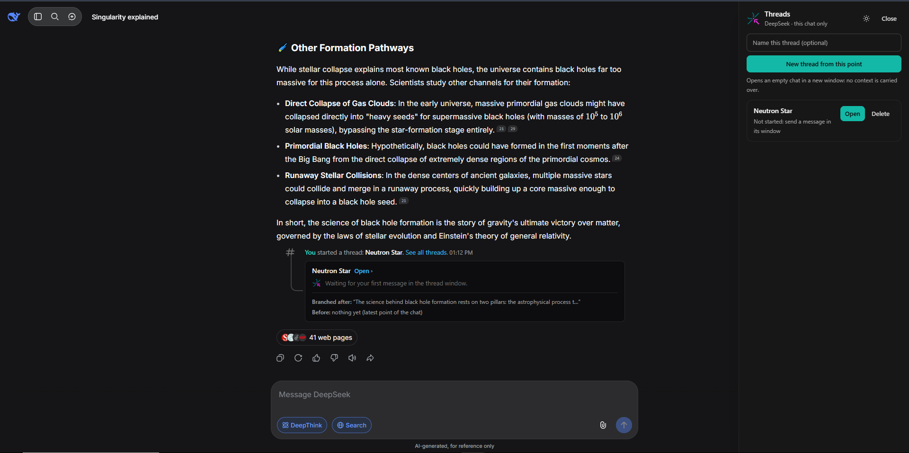

# AI Thread System

**Branch off-topic tangents from your AI chats into their own threads, right where they started, without
cluttering the main conversation.** Think Discord threads, but for ChatGPT, Claude, Gemini and DeepSeek.

Created by **Tayyab Soban** · Repository: https://github.com/tayyab-ai/Ai-Thread-System



*The Threads panel (right) and the Discord-style thread box inside the chat (DeepSeek, dark mode).*

100% local. No servers, no accounts, no tracking. Your chats never leave your browser.

---

## Why

You are deep in a long chat and a side question pops up. Asking it in the same chat pollutes the conversation.
Opening a new chat makes you lose track of where the tangent started. This extension fixes that.

## What it does

- **Start a thread from any point in a chat.** It opens a clean, empty chat in a new window, so the side topic does
  not mix with the main one.
- **See where you branched.** A Discord-style box appears in the main chat right after the message you branched from.
  It shows the thread title, message count, the latest message, and which message it came *after* and *before*.
- **Merge back.** Inside a thread, press **Merge to main** to add its last AI reply to the main chat's message box
  (nothing is sent automatically). The thread is then marked **✓ Merged**.
- **Delete for real.** Deleting a thread also deletes its actual chat on the AI site.
- **Threads stay in their own chat.** A thread only shows in the chat it was created in, and only on the site it
  belongs to (ChatGPT threads never appear on Claude, and so on).
- **Dark and light mode** with a toggle button.

## Supported sites

| Site | Status |
| --- | --- |
| ChatGPT (`chatgpt.com`) | Tested and working |
| DeepSeek (`chat.deepseek.com`) | Tested and working (the thread box anchors on AI replies only) |
| Claude (`claude.ai`) | Included, not fully tested |
| Gemini (`gemini.google.com`) | Included, not fully tested |

Works in Chrome and other Chromium browsers (Edge, Brave, Opera…).

## Install (about 1 minute)

1. On this page, click the green **Code** button, then **Download ZIP**.
2. Extract the ZIP. Inside you will find a folder named **`extension`**.
3. In Chrome, open `chrome://extensions`.
4. Turn on **Developer mode** (top right).
5. Click **Load unpacked** and select the **`extension`** folder (the one that contains `manifest.json`).
6. Open ChatGPT (or another supported site) and refresh the page. A small logo tab appears on the right edge.

## How to use

1. Open a chat that already has at least one message, then click the logo tab on the right edge to open the
   **Threads** panel.
2. Optionally type a name and press **New thread from this point**. A new window opens with an empty chat.
   Send your first message there.
3. Go back to the main chat. The thread box now sits where you branched. Click it any time to reopen the thread.
4. In the thread window, open the panel and press **Merge to main** to bring its last reply back, or **Delete thread**
   to remove it together with its chat.
5. Use the sun/moon button in the panel to switch between dark and light mode.

## Privacy

There is no backend. Everything is stored locally in your browser. Only the thread title, the chat addresses, a short
snippet of the message you branched from, a short preview of the last message, and the message count are saved.
Full conversations are not copied. The extension only runs on the supported AI sites.

## Troubleshooting

| Problem | What to do |
| --- | --- |
| The logo tab does not appear | Refresh the AI page after installing or updating. |
| "Open a saved chat first" | Send a message first, so the chat exists, then try again. |
| A thread says "Not started" | Send a message in the thread's window. |
| The thread box is missing | Scroll to the message you branched from, or wait a moment. |
| A yellow notice says a chat could not be deleted | Delete that chat by hand from the site's chat list, then dismiss the notice. |
| Something stopped working after a site update | AI sites change their pages often. Please open an Issue on this repository. |

## For developers

The `source` folder contains the full code (WXT, React, TypeScript, Tailwind CSS, Framer Motion).

```bash
git clone https://github.com/tayyab-ai/Ai-Thread-System.git
cd Ai-Thread-System/source
npm install
npm run build        # output: source/.output/chrome-mv3
```

Each AI site has its own adapter in `source/src/adapters/`. If a site changes its page and something breaks, the fix
is usually a selector in that file.

Please note: this is an unofficial project and is not affiliated with OpenAI, Anthropic, Google or DeepSeek. It works
by interacting with pages you already have open, as you would by hand. Use it at your own risk.

## License

[MIT](LICENSE) © 2026 Tayyab Soban
